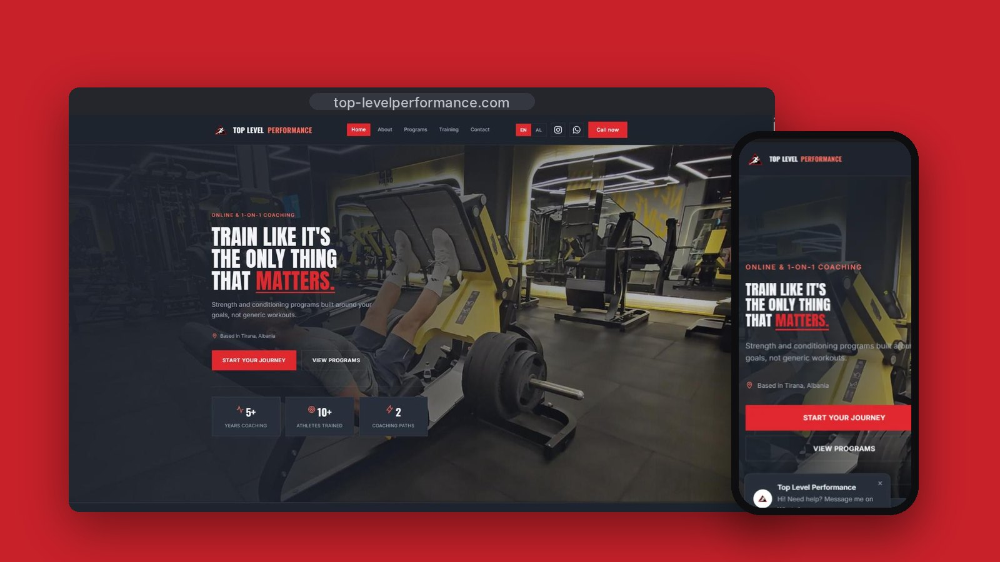
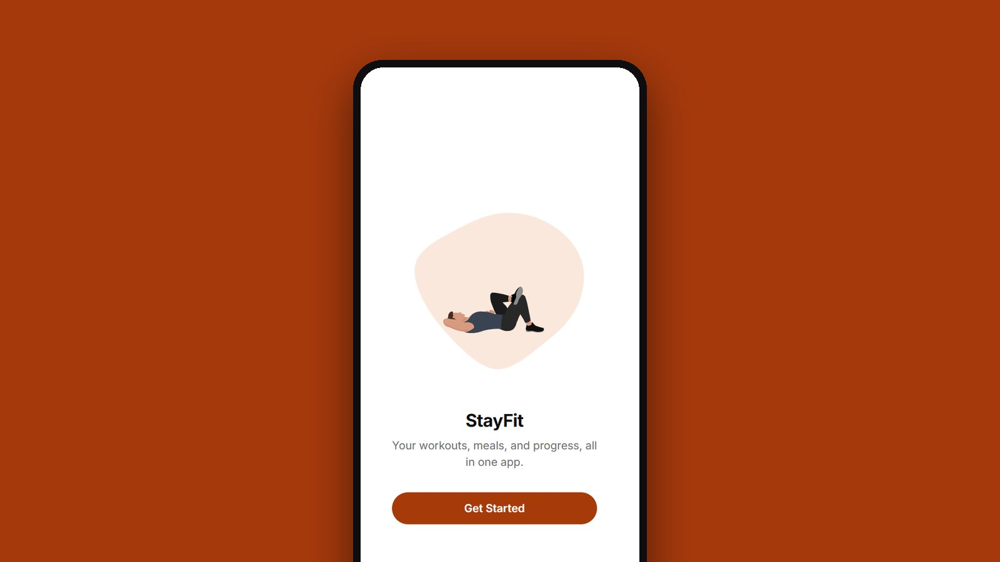
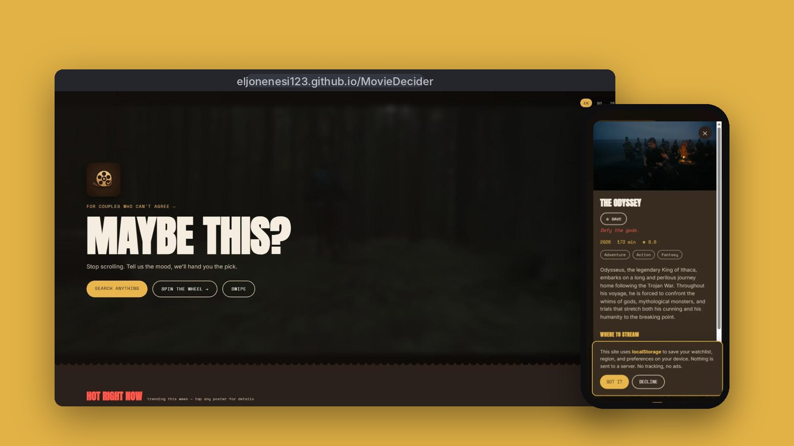
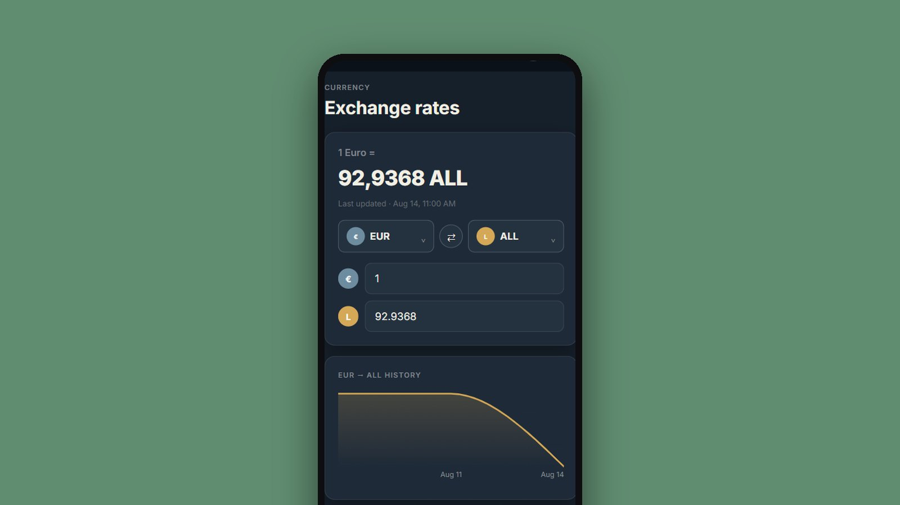
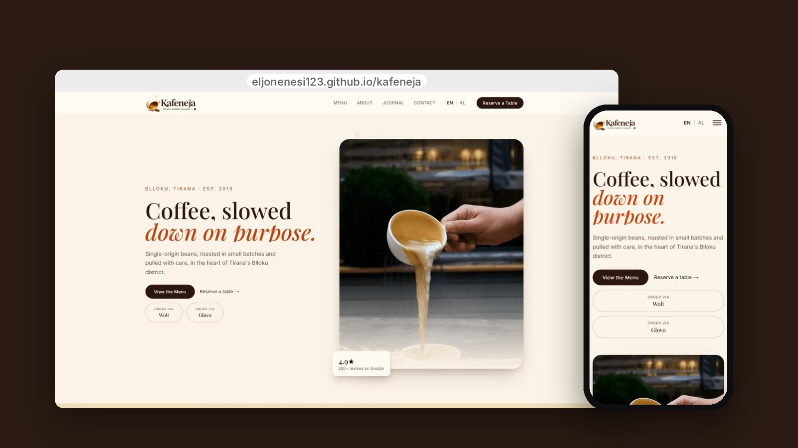
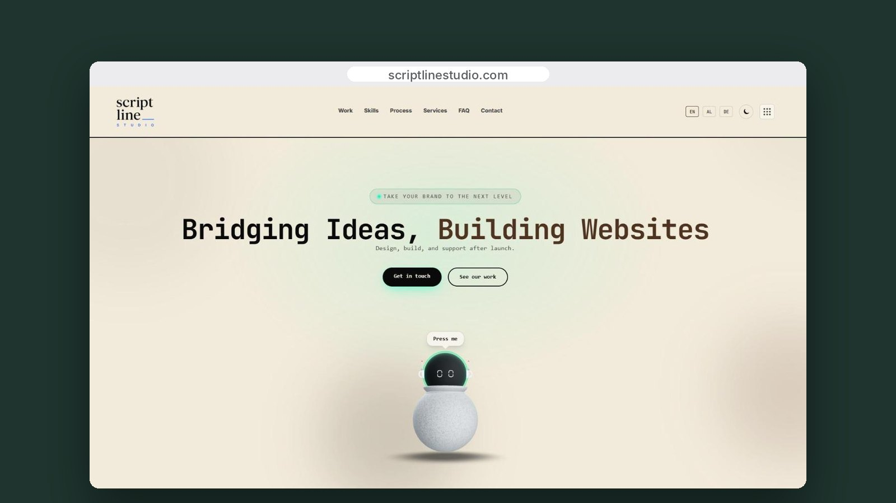

<!-- Animated banner -->

<!-- Typing line -->

  

<!-- Contact badges -->

  
  
  
  

## Hey, I'm Eljon 👋

I'm a web developer from Tirana with a degree in Business IT, which means I care about two things at once: that the code works, and that it actually does something for the business paying for it.

By day I work in IT at **One Albania** and on the front-end at **Higherd**. The rest of the time I run **[Script Line Studio](https://scriptlinestudio.com)**, a small studio where I build websites and online stores for businesses, from coffee shops in Tirana to coaches with clients abroad. Most of what you see here is real client work, live on real domains.

## 🛠️ What I work with

  

Mobile-first, always. Most people will see your site on their phone first. I build in English, Albanian and German.

## 🚀 Projects

<table>
  <tr>
    <td width="50%" valign="top">
      
      <h3><a href="https://github.com/eljonenesi123/TopLevelPerformance">Top Level Performance</a></h3>
      
Site for a strength and conditioning coach: programs, pricing, bilingual pages, a client questionnaire and GA4 funnel tracking. Real client, real leads.

        
       <a href="https://top-levelperformance.com"><b>Live site</b></a>
    </td>
    <td width="50%" valign="top">
      
      <h3><a href="https://github.com/eljonenesi123/StayFit">StayFit</a></h3>
      
Fitness app for your phone: interval timer, exercise library, calorie tracker, AI workout and meal plans, and photo exercise recognition. Installable as a PWA.

        
       <a href="https://eljonenesi123.github.io/StayFit/"><b>Live app</b></a>
    </td>
  </tr>
  <tr>
    <td width="50%" valign="top">
      
      <h3><a href="https://github.com/eljonenesi123/MovieDecider">Just Pick Something</a></h3>
      
For the nights nobody can decide what to watch. Spin a wheel, swipe through picks, or play the group games. Works offline, three languages.

        
       <a href="https://eljonenesi123.github.io/MovieDecider/"><b>Live app</b></a>
    </td>
    <td width="50%" valign="top">
      
      <h3><a href="https://github.com/eljonenesi123/mymoney-app">MyMoney</a></h3>
      
Expense tracker where you photograph a receipt and OCR fills in the amount and merchant (yes, even Albanian receipts).

        
    </td>
  </tr>
  <tr>
    <td width="50%" valign="top">
      
      <h3><a href="https://github.com/eljonenesi123/kafeneja">Kafeneja</a></h3>
      
Website for a specialty coffee shop in Tirana, with menu, journal, table reservations and Wolt/Glovo ordering.

       
    </td>
    <td width="50%" valign="top">
      
      <h3><a href="https://github.com/eljonenesi123/WebDev">Script Line Studio</a></h3>
      
My studio's own site, with a 3D robot named Bob who handles the welcomes.

        
       <a href="https://scriptlinestudio.com"><b>Live site</b></a>
    </td>
  </tr>
</table>

## 📊 GitHub activity

  
  

## 📫 Let's talk

I'm open to front-end and web developer roles, and always happy to hear about a project. The fastest way to reach me is [email](mailto:eljonenesi9@gmail.com) or [LinkedIn](https://linkedin.com/in/eljonenesi).

